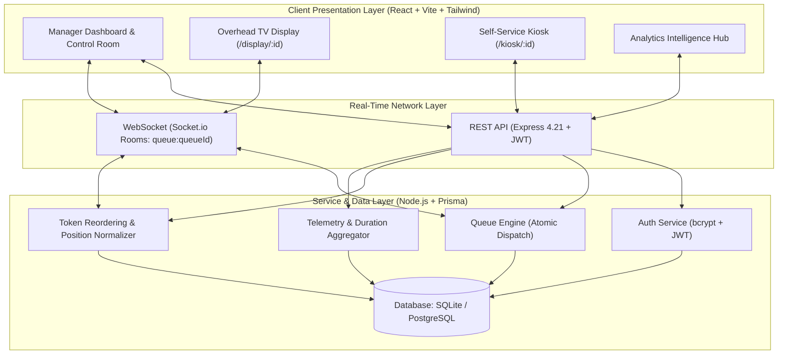

# ⚡ QFlow - Next-Generation Smart Queue & Token Management Platform

[](https://www.typescriptlang.org/)
[](https://react.dev/)
[](https://tailwindcss.com/)
[](https://nodejs.org/)
[](https://expressjs.com/)
[](https://www.prisma.io/)
[](https://socket.io/)
[](https://opensource.org/licenses/MIT)

> A production-grade, real-time, full-stack Queue Management System built for banks, hospitals, customer service centers, and retail counters. Features manager authentication, dynamic queue creation, token reordering, one-click service assignment, overhead TV display boards, self-service kiosks, and deep wait-time analytics.

---

## 📸 Key Features & Visual Highlights

- 🎨 **Vibrant, High-Impact UI (Not Minimal)**: Rich glassmorphism with glowing neon gradients (Indigo, Purple, Emerald, Rose, Amber), animated pulses, interactive Recharts visualizations, and Web Audio API synthesizer chimes.
- 🔐 **Manager Authentication & RBAC**: Secure JWT-based authentication with bcrypt password hashing and pre-configured demo logins.
- 📋 **Multi-Queue Orchestration**: Create and manage multiple service counters with custom prefixes (`VIP`, `CS`, `EXP`, `RX`), counter designations, and target service durations.
- 🎟️ **Instant Smart Token Generation**: Sequential token numbering, customer metadata, contact tracking, and priority tiers (**👑 VIP**, **Urgent**, **Standard**).
- ⬆️⬇️ **Real-Time Token Reordering**: Move tokens up and down dynamically with atomic database transactions and instant WebSocket broadcast.
- 🛎️ **One-Click Top Token Dispatch**: Assign the top waiting token to service with a single click, triggering an audio chime and service timer.
- ❌ **Token Cancellation**: Drop tokens with structured cancellation reasons (e.g. *No Show*, *Customer Request*), automatically shifting subsequent tokens up.
- 📊 **Executive Analytics Dashboard**: Interactive charts tracking wait-time trends, hourly arrival surges, customer priority distribution, desk benchmarks, and CSV report export.
- 📺 **Overhead TV Waiting Room Display**: Dedicated fullscreen presentation view (`/display/:id`) for overhead lobby monitors with live call flash and chime.
- 📱 **Customer Self-Service Kiosk**: Touch-friendly public portal (`/kiosk/:id`) where walk-in visitors can generate tokens and get digital tickets.

---

## 🎯 Evaluation Requirements Matrix

| Requirement | Implementation Detail | Location |
| :--- | :--- | :--- |
| **1. Manager Login & Queue Creation** | JWT Auth with bcrypt, modal to create customized queues with colors, prefixes, and counters | `src/pages/Login.tsx`, `src/pages/QueuesDashboard.tsx` |
| **2. Queue Name** | Each queue maintains unique name, slug, prefix, and designated service counter | `prisma/schema.prisma`, `backend/src/controllers/queueController.ts` |
| **3. Add Persons / Tokens** | Modal creates tokens with sequential numbers (e.g. `CS-005`), priority, and notes | `src/pages/QueueControlRoom.tsx`, `POST /api/tokens/queue/:id` |
| **4. Display Waiting List** | Real-time sorted list showing token number, name, wait duration, priority badge | `src/pages/QueueControlRoom.tsx` |
| **5. Move Tokens Up & Down** | Dedicated Up/Down buttons executing atomic swap transactions with position normalization | `PATCH /api/tokens/:id/move` |
| **6. Assign Top Token to Service** | One-click button dispatches top token to `SERVING`, begins timer, shifts line up | `POST /api/tokens/queue/:id/serve-top` |
| **7. Cancel Token** | Single-click cancel with reason logging and position collapse | `POST /api/tokens/:id/cancel` |
| **8. Analytics Dashboard** | Wait times, arrival surges, service speeds, priority donut, cancellation rates, CSV export | `src/pages/AnalyticsDashboard.tsx`, `GET /api/analytics` |

---

## 🏗️ Architecture & Interview Technical Details

### 1. High-Level System Architecture



### 2. Relational Schema Design

```prisma
model User {
  id           String   @id @default(cuid())
  email        String   @unique
  name         String
  password     String
  role         String   @default("MANAGER") // MANAGER, STAFF, ADMIN
  queues       Queue[]  @relation("ManagerQueues")
  servedTokens Token[]  @relation("ServedTokens")
}

model Queue {
  id                String   @id @default(cuid())
  name              String
  description       String?
  prefix            String   @default("Q")
  color             String   @default("#6366F1")
  counterName       String   @default("Counter 1")
  targetServiceTime Int      @default(5) // in minutes
  status            String   @default("ACTIVE")
  managerId         String
  manager           User     @relation("ManagerQueues", fields: [managerId], references: [id])
  tokens            Token[]
}

model Token {
  id                 String    @id @default(cuid())
  tokenNumber        String    // e.g. "VIP-002", "CS-104"
  sequenceNumber     Int
  customerName       String
  customerPhone      String?
  priority           String    @default("NORMAL") // NORMAL, PRIORITY, VIP
  status             String    @default("WAITING") // WAITING, SERVING, COMPLETED, CANCELLED
  position           Int       @default(1) // 1-indexed waiting position
  cancellationReason String?
  counterName        String?
  createdAt          DateTime  @default(now())
  servedAt           DateTime?
  completedAt        DateTime?
  cancelledAt        DateTime?
  waitTimeSeconds    Int?
  serviceTimeSeconds Int?
  queueId            String
  queue              Queue     @relation(fields: [queueId], references: [id])
}
```

### 3. Key Algorithms & Technical Decisions (For Interview Discussion)

1. **Atomic Token Reordering & Zero-Gap Queue Consistency**:
   - When a manager moves a token Up or Down, the backend executes an atomic Prisma `$transaction` swapping positions between adjacent tokens.
   - If any manual reordering or cancellation creates gaps in sequence, the `normalizeQueuePositions(queueId)` routine re-indexes all active waiting tokens into a contiguous `1, 2, ..., N` sequence.
2. **One-Click Dispatch Algorithm**:
   - The top waiting token (lowest position, typically `#1`) is queried.
   - Any currently active serving token on that counter is transitioned to `COMPLETED` with its `serviceTimeSeconds` recorded.
   - The top token's status becomes `SERVING`, timestamp `servedAt` is locked, `waitTimeSeconds` is computed as `servedAt - createdAt`, and position is set to `0`.
   - All subsequent tokens are decremented (`position: { decrement: 1 }`).
   - An event `token_served` is emitted to the queue's WebSocket room to trigger UI updates and sound chimes on all listening screens.
3. **Sub-Millisecond Native Audio Synthesis**:
   - Rather than relying on external MP3 audio files (which can fail due to CORS, network latency, or browser audio blocking), QFlow includes a custom synthesizer using the native browser **Web Audio API**. It synthesizes dual-tone bell chimes (E5 at 659Hz and B5 at 987Hz) with exponential gain decay.
4. **Dual Database Architecture (Zero Setup vs Cloud Production)**:
   - Out of the box, QFlow runs with SQLite (`file:./dev.db`), requiring **zero** cloud database provisioning, credentials, or container setup.
   - For production deployment on AWS/Render/Railway, simply change `DATABASE_URL` in `.env` to PostgreSQL or Supabase and run `npx prisma db push`.

---

## 🚀 Quick Start Guide

### Prerequisites
- Node.js 18+ (tested on Node v20/v24)
- npm or yarn

### 1. Clone the Repository
```bash
git clone https://github.com/rohitt2008/Queue_mgnt.git
cd Queue_mgnt
```

### 2. One-Command Setup
Install all dependencies for root, backend, and frontend with a single command:
```bash
npm run install:all
```

### 3. Seed Database with Rich Demo Data
Populates realistic queues, active serving counters, waiting lists, and historical tokens for instant analytics charts:
```bash
npm run seed
```

### 4. Run Full Stack in Development Mode
Starts both the Express API and Vite React frontend concurrently:
```bash
npm run dev
```

- **Frontend App**: [http://localhost:5173](http://localhost:5173)
- **Backend API**: [http://localhost:5001](http://localhost:5001)
- **API Health Check**: [http://localhost:5001/health](http://localhost:5001/health)

---

## 🔑 Pre-Configured Demo Accounts (1-Click Login)

The login screen features an **instant 1-click access box** with 4 pre-configured roles:

| Account Role | Badge | Email | Password | Assigned Counter / Queue |
| :--- | :--- | :--- | :--- | :--- |
| **Sarah Jenkins** | `👑 SUPER ADMIN` | `admin@rugas.com` | `password123` | VIP Wealth & Premier Desk |
| **Alex Rivera** | `⚡ OPERATIONS LEAD` | `lead@rugas.com` | `password123` | Customer Support Desk 2 |
| **David K. Miller** | `🛡️ QUEUE MANAGER` | `manager@rugas.com` | `password123` | Express Billing Counter 3 |
| **Elena Rostova** | `🎯 COUNTER STAFF` | `staff@rugas.com` | `password123` | Prescription Dispense Window A |

> 💡 **Tip:** Simply click on any account card on the Login screen to authenticate immediately without typing credentials!

---

## 📡 REST API Reference

### Authentication
- `POST /api/auth/register` - Create manager account (`name`, `email`, `password`, `role`)
- `POST /api/auth/login` - Authenticate manager & return JWT
- `GET /api/auth/me` - Fetch authenticated manager profile

### Queues
- `GET /api/queues` - List all queues with live waiting/serving metrics
- `GET /api/queues/:id` - Get detailed queue configuration & stats
- `POST /api/queues` - Create queue (`name`, `prefix`, `counterName`, `color`, `targetServiceTime`)
- `PATCH /api/queues/:id` - Update queue settings
- `DELETE /api/queues/:id` - Delete queue and cascade tokens

### Tokens (Requirements 3, 4, 5, 6, 7)
- `POST /api/tokens/queue/:queueId` - **(Req 3)** Add new person / generate token
- `GET /api/tokens/queue/:queueId` - **(Req 4)** Display waiting list & currently serving token
- `PATCH /api/tokens/:id/move` - **(Req 5)** Move token `up` or `down` in queue
- `POST /api/tokens/queue/:queueId/serve-top` - **(Req 6)** One-click dispatch top token to service
- `POST /api/tokens/:id/complete` - Mark service complete & record duration
- `POST /api/tokens/:id/cancel` - **(Req 7)** Cancel token with reason

### Analytics (Requirement 8)
- `GET /api/analytics/:queueId?timeframe=today` - Aggregate telemetry on wait times, hourly surges, priority distribution, and queue comparisons

---

## 🚢 Production Build

```bash
# Build backend and frontend
npm run build

# Start production server
cd backend && npm start
```

---

## 👨‍💻 Author & Acknowledgements
Developed with passion by **Rohit Kumar** for the **Rugas Team** technical evaluation.
Repository: [https://github.com/rohitt2008/Queue_mgnt.git](https://github.com/rohitt2008/Queue_mgnt.git)
